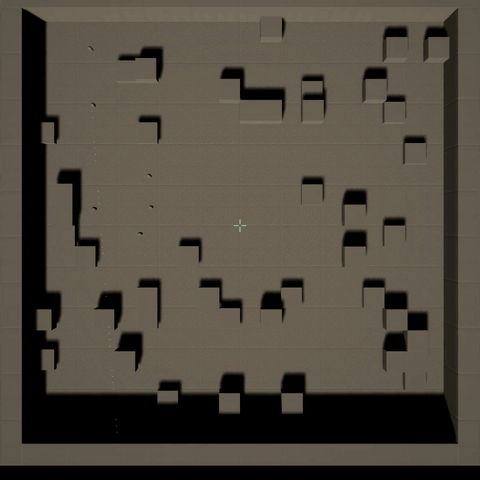
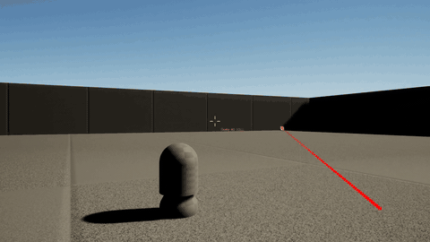
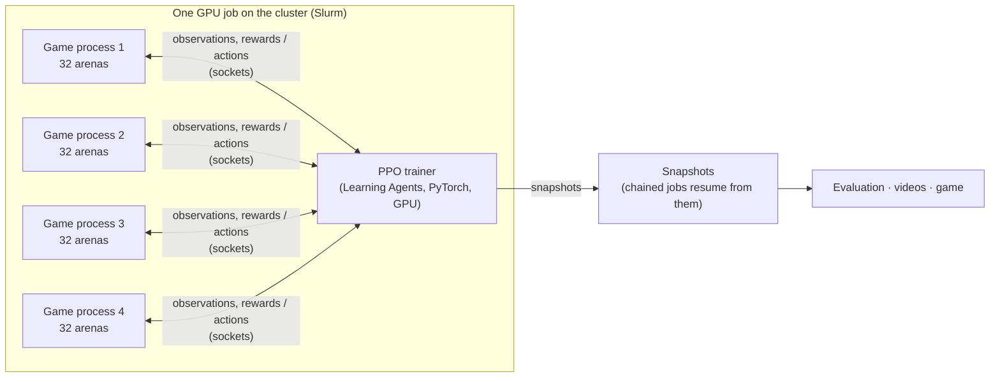

# FPS-Agent: beans with guns

**Reinforcement-learning agents that learn to find, track and shoot moving opponents in a tactical-shooter sandbox built in Unreal Engine 5.7.** They train headless and in parallel on a GPU cluster, and are meant to become drop-in enemies for a real game.

<p align="center">
  
  
</p>
<p align="center"><sub>The current agent at the hardest level of its stage: five moving bots, random cover, the agent can move, walk and shoot. Left: its own view. Right: from above (red tracer = hit, yellow = miss). Full-quality clips: <a href="docs/media/s1-walk-firstperson.mp4">first person</a> · <a href="docs/media/s1-walk-topdown.mp4">top-down</a>.</sub></p>

## Motivation and goal
Shooter bots are usually scripted. They either cheat, with perfect aim and knowledge of where you are, or they feel robotic and predictable. This project trains opponents instead:
- **Fair:** the agent perceives the world roughly as a player does. It sees what is in its view cone and in line of sight, and hears nearby footsteps and gunshots, but knows nothing through walls. It gets no pixels either: its senses are geometric, so training runs fully headless.
- **Learned:** aiming, tracking, when to stop and shoot, and how to search are all learned from reward. None of it is hand-written.
- **Usable in a game:** the long-term goal is an enemy you can drop into a game and tune for difficulty.

## Performance
Each curriculum stage ends with a promotion test: 200 fixed-seed episodes at the hardest level. The agent must **clear** at least 70% of them, killing every bot before the time limit.

| Stage | Agent | Clear rate | Accuracy | Headshots (of hits) | Time per clear |
|---|---|---:|---:|---:|---:|
| **S0** aim gallery: 1–5 static bots, agent can't move | trained policy | **98.5%** | 56% | 54% | 4.1 s |
| **S1** movers: 1–5 moving bots, random cover, hearing | full mobility (move, walk, crouch, jump) | **76.0%** | 30% | 14% | 17.6 s |
| **S1** movers | **walk model** (move, walk, shoot; no crouch, no jump) | **73.0%** | 25% | 34% | 14.8 s |
| S1 movers | *scripted reference: an aimbot with the same senses* | *85.0%* | *44%* | *99%* | *9.7 s* |

The **walk model** is the line meant for the game: it relies on movement and aim instead of crouch-spam or jumping. Next is **S2**, where the bots shoot back.

<p align="center">
  
  
</p>
<p align="center"><sub>Left: the S0 agent snapping onto static targets (<a href="docs/media/s0-firstperson.mp4">video</a>). Right: an S1 arena from above, with fresh random cover every episode.</sub></p>

## Training architecture


**Environment (Unreal Engine 5.7, C++).**
- **Characters:** "beans" (capsules) with tactical-shooter movement: run 5.4 m/s, walk, crouch, jump, snappy acceleration. Their rifle is hitscan, with per-hitbox damage (head 160, body 40, legs 34), movement-dependent spread, a recoil pattern, a fire rate of 9.75 rounds/s and reloads.
- **Arenas:** each game process hosts **32 isolated arenas**. Each arena holds one learning agent and its scripted bots, and resets on its own. The world is built at runtime from JSON map specs.
- **Simulation:** fixed 60 Hz physics, run as fast as the CPU allows. It runs headless (`-nullrhi -nosound`) on Linux; the build is cross-compiled from Windows.

**Agent.**
- **Decisions:** 15 per second (every 4th physics tick).
- **Observations, all fair:**
  - 72 distance rays (24 directions × 3 pitches, 30 m) that only hit level geometry;
  - its own state: velocity, health, ammo, spread, recoil;
  - up to 5 enemies, but only ones in line of sight inside a 103° × 70° view cone, or seen in the last 2 s. Each gives position, distance, aim error (coarse and fine channels), velocity, facing and crouch state;
  - a hit indicator;
  - up to 4 heard footsteps and gunshots, with a rough position.
- **Actions:**
  - move (2 axes);
  - aim (yaw and pitch rates, capped at 720°/s like a human flick);
  - fire, reload, walk, crouch, jump. Crouch and jump are switched off for the walk model.
- **Network:** a shared encoder with **attention over the enemy and sound sets**, a policy MLP of 2 × 256, and a **GRU memory** of 128. It is trained with **PPO** (discount 0.995, GAE λ 0.95).

**Reward.**
- **Positive:** damage dealt (a kill from full health is worth about 1), a kill bonus, a clear bonus that grows the faster the arena is cleared, and a one-time bonus for spotting each enemy.
- **Penalties:** small ones for missed bullets and for elapsed time, plus damage taken and death.
- **Aim helper:** a potential-based term in the early stages guides the aim without changing the optimal policy.
- Accuracy and headshot rate are measured, never rewarded. Rewarding them would teach the agent not to shoot.

**Curriculum.**
- **Stages:** each one starts from the previous stage's best weights.
  - **S0:** static targets.
  - **S1:** strafing, peeking, crouching, patrolling and exploring bots between random cover. The bots have the same fair senses and investigate what they hear.
  - **S2:** bots shoot back. Reaction 600 → 200 ms, aim error 6° → 1.5°.
  - **S3:** full procedural maps with hunter bots.
- **Difficulty ramp:** inside a stage, a ramp per arena raises the difficulty when the recent clear rate passes 70% and lowers it below 40%. That covers bot count, distance, speed, behaviour mix and cover density. 20% of episodes replay easier levels so earlier skills aren't forgotten.
- **Promotion:** once the difficulty stays near the top, the 200-episode promotion test decides whether the stage is done.

**Scale.** One job runs 4 game processes × 32 arenas = **128 agents in parallel** against one GPU trainer. That's about **12 s per training batch** on an NVIDIA L40S, or roughly 1,000 batches in 3.5 hours. Jobs save snapshots periodically and chain across cluster time limits.

## Framework stack
| Layer | Technology |
|---|---|
| Game and simulation | Unreal Engine 5.7 (C++), headless Linux builds, fixed 60 Hz timestep |
| Reinforcement learning | Epic **Learning Agents** (PPO), Python 3.11 trainer, PyTorch + CUDA |
| Compute | UTRGV **Cradle** HPC cluster, Slurm, NVIDIA L40S / A100 GPUs |
| Build pipeline | Windows → Linux cross-compile (clang 20 toolchain), packaged builds and trained snapshots shipped as GitHub Releases |
| Maps | Python map generator and validator (`tools/mapgen`): original layouts on a 4 m grid, 8 validation rules, built in-engine from JSON |
| Tests and media | Unreal automation tests (73, headless), pytest, ffmpeg for frame-exact policy videos |

## Maps
<p align="center">
  
  
</p>
<p align="center"><sub>Left: <code>map01</code>, an original blockout map with two sites, mid, ramps and elevation. Right: the 50-map procedural pool for the later stages.</sub></p>

## Running the evaluation
**Requirements (Windows):** Unreal Engine **5.7.4**, Visual Studio 2022 Build Tools (MSVC 14.44), Python via conda (for `tools/mapgen` only), the GitHub CLI `gh`, and `ffmpeg` (for videos).

```powershell
# 1. Build the editor target and run the tests (editor closed)
powershell -File tools/build.ps1
powershell -File tools/run_tests.ps1

# 2. Get a trained model (encoder.bin, policy.bin, decoder.bin) from the releases
gh release download run-S1-walk-20261114-152929 -D models/s1-walk

# 3. Promotion test, headless: 200 fixed-seed episodes at the hardest level
$ue = "C:\Program Files\Epic Games\UE_5.7\Engine\Binaries\Win64\UnrealEditor-Cmd.exe"
& $ue "$PWD\Game\FPSAgent\FPSAgent.uproject" -game -nullrhi -nosound -unattended `
  -Stage=S1 -Eval -EvalEpisodes=200 -StartDifficulty=1 -Seed=1000 -Arenas=32 `
  -ResumeFrom="$PWD\models\s1-walk" -Set="Combat.Abilities.bCrouch=false;Combat.Abilities.bJump=false" `
  -EvalJson="$PWD\eval.json" -abslog="$PWD\eval.log"
```
- **Output:** `eval.json` (and a `CombatEval:` log line) holds the clear rate, accuracy, headshot rate, time per clear, kills per episode and every reward term.
- **Scripted reference:** replace `-ResumeFrom=...` with `-Scripted`.
- **Quick check:** use `-EvalEpisodes=40 -Arenas=4`.
- **Full-mobility model:** use `run-S1-20261113-L009` without the `-Set`.

```powershell
# Watch it live (real time, top-down; ~ opens the console: fps.WatchAgent 0 = agent's eyes, fps.ShowHitboxes 1)
& "C:\Program Files\Epic Games\UE_5.7\Engine\Binaries\Win64\UnrealEditor.exe" "$PWD\Game\FPSAgent\FPSAgent.uproject" -game -windowed `
  -Stage=S1 -Infer -Arenas=1 -StartDifficulty=1 -ResumeFrom="$PWD\models\s1-walk" `
  -Set="Combat.Abilities.bCrouch=false;Combat.Abilities.bJump=false" -ExecCmds="fps.TopDown 1, fps.ShowShots 1, t.MaxFPS 60"

# Record a frame-exact MP4 (real-time playback whatever the render speed)
powershell -File tools/record_policy_video.ps1 -Snapshots models/s1-walk -Stage S1 -View TopDown -Set "Combat.Abilities.bCrouch=false;Combat.Abilities.bJump=false"
```

**On the cluster:** `cluster/slurm/combat.sbatch` runs the same promotion test as a Slurm job, with `MODE=eval` plus `RESUME_FROM=<snapshot dir>`, or `SCRIPTED=1` for the reference. Training jobs use `MODE=train`.

## Repository layout
| Path | Contents |
|---|---|
| `Game/FPSAgent/Source/FPSAgent/` | C++: `Character` (bean, hitboxes), `Weapons` (rifle math), `Bots` (scripted bots, senses, tile pathfinding brain), `Arena` (runtime map building, tile graph), `Learning` (observations, actions, rewards, curriculum, training loop), `Tests` |
| `Game/FPSAgent/Content/MapSpecs/` | Map specs (JSON): `map01` and the generated pool |
| `tools/` | Build, tests, Linux packaging, the policy video recorder, and `mapgen` (map generator and validator) |
| `cluster/` | Slurm jobs and helper scripts, the trainer environment, and the pinned Learning Agents trainer |
| `docs/media/`, `docs/maps/` | Videos, GIFs and map images |

## Principles
- No computer vision: rays and line of sight only.
- No information through walls, except hearing and a hit indicator.
- Agents train only against scripted bots.
- Everything works headless.
- Every mechanic and reward value is data, not a constant.
- Original maps and generic names only.
