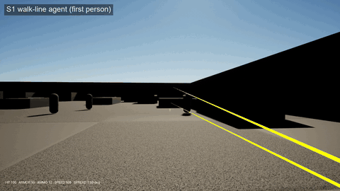
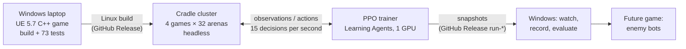
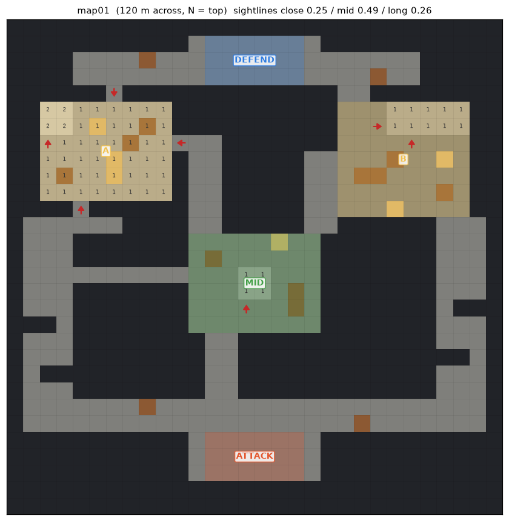
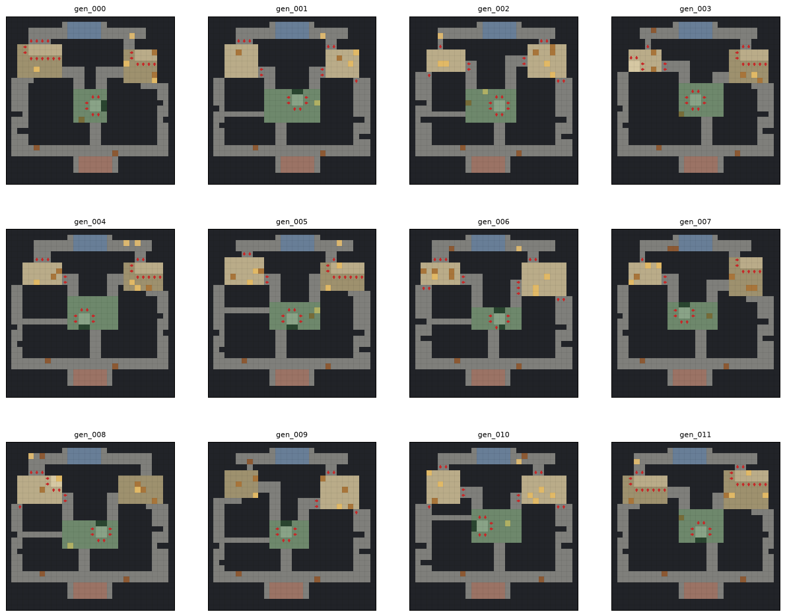

# FPS-Agent: beans with guns

**Reinforcement-learning agents that learn to find, track and shoot moving opponents in a tactical-shooter sandbox built in Unreal Engine 5.7.** They train headless and in parallel on a university GPU cluster. The end goal is a drop-in enemy for a real game.

<p align="center">
  
  
</p>
<p align="center"><sub>The current agent (<code>S1-walk</code>) at the hardest S1 level, against five moving bots between random cover. Left: its own view. Right: from above (red tracer = hit, yellow = miss). Full-quality clips: <a href="docs/media/s1-walk-firstperson.mp4">first person</a>, <a href="docs/media/s1-walk-topdown.mp4">top-down</a>.</sub></p>

---

## What it is
- **The agents.** "Beans with guns": capsule characters with tactical-shooter mechanics. That means run, walk, crouch and jump movement, and a hitscan rifle with per-hitbox damage, movement-dependent spread, a recoil pattern and reloads.
- **How they learn.** By trial and error (PPO through Epic's **Learning Agents** plugin), **only against scripted bots**. They never train against each other.
- **What they perceive.** Fair senses only: 72 distance rays, line-of-sight checks inside a 103° view cone, a 2 s memory, hearing of enemy footsteps and gunshots, and a hit indicator. **No pixels, no wallhacks.**
- **Where they train.** Every mechanic is data, and everything runs headless (`-nullrhi`). One GPU job runs 4 game processes × 32 arenas = **128 agents in parallel** on the UTRGV **Cradle** Slurm cluster.
- **Maps.** Original layouts only, built at runtime from JSON specs: a hand-made map and a 50-map procedural pool.

## Results so far
Each stage ends with a promotion test: 200 fixed-seed episodes at the hardest level, and the agent must clear at least 70% (kill every bot before the time limit).

| Stage | Run | Mobility | Clear rate | Accuracy | Headshots (of hits) | Time per clear |
|---|---|---|---:|---:|---:|---:|
| **S0** aim gallery: static bots, agent can't move | `S0-20261112-152039` | static | **98.5%** | 56% | 54% | 4.1 s |
| **S1** movers: moving bots, cover, hearing | `S1-20261113-L009` | full | **76.0%** | 30% | 14% | 17.6 s |
| **S1** movers, no crouch or jump | `S1-walk-20261114-152929` | **walk** | **73.0%** | 25% | 34% | 14.8 s |
| *Scripted reference: an aimbot with the same senses* | – | – | *85.0%* | *44%* | *99%* | *9.7 s* |

The **`walk`** line (move, walk and shoot; no crouch, no jump) is the line headed for the game. Training continues on it, and **S2**, where the bots shoot back, is being built. Details are in [`docs/runs/`](docs/runs/), and the live state is in [`docs/STATUS.md`](docs/STATUS.md).

<p align="center">
  
  
</p>
<p align="center"><sub>Left: the S0 agent, which can't move yet, snapping onto static targets (<a href="docs/media/s0-firstperson.mp4">video</a>). Right: an S1 arena from above, with fresh random cover every episode.</sub></p>

## How it works


- **Two Claude Code sessions** run the project together: one on the Windows laptop (game code, builds) and one on the cluster (training jobs). [`docs/STATUS.md`](docs/STATUS.md) is their mailbox, and git is the only channel between them.
- **The curriculum:** each stage starts from the previous stage's best snapshot. Inside a stage, an automatic difficulty ramp per arena moves from 1 bot to 5, and from slow to fast bots.

  | Stage | Opponents | Agent learns | Status |
  |---|---|---|---|
  | S0 aim gallery | Static bots | Aim and timing | ✅ promoted |
  | S1 movers | Strafing, peeking, patrolling and exploring bots; cover; footsteps | Tracking, moving to find targets, stopping to shoot | ✅ promoted (`full` and `walk`) |
  | S2 duels | Bots that shoot back: reaction 600 → 200 ms, aim error 6° → 1.5° | Trading damage, using cover | 🛠️ build C in progress |
  | S3 hunt | Full procedural maps, hunter bots | Searching maps, fighting on the move | planned |
- **Rewards:** damage dealt, kills, a clear bonus for fast wipes, a one-time bonus for spotting each enemy, small penalties for misses and wasted time, and death. Accuracy and headshot % are tracked as metrics, never rewarded.

## Maps
<p align="center">
  
  
</p>
<p align="center"><sub>Left: <code>map01</code>, an original blockout map with two sites, mid, ramps and elevation. Right: the 50-map procedural pool. All maps are 4 m tile grids, validated by 8 rules before use.</sub></p>

## Repository layout
| Path | What's there |
|---|---|
| `Game/FPSAgent/` | The UE 5.7 project. C++ in `Source/FPSAgent/{Character, Weapons, Bots, Arena, Learning, Eval, Tests}` |
| `tools/` | Build, test, Linux packaging, policy video recorder, and `mapgen` (the Python map generator and validator) |
| `cluster/` | Slurm jobs, scripts and the pinned Learning Agents trainer |
| [`docs/handbook.md`](docs/handbook.md) | **The full design and runbook**: mechanics, RL design, command-line arguments, workflow, cluster guide |
| [`docs/STATUS.md`](docs/STATUS.md) · [`docs/decisions.md`](docs/decisions.md) | Live status and requests · every design decision with its reason |
| [`docs/builds.md`](docs/builds.md) · [`docs/runs/`](docs/runs/) | Every build and every training run, with results |
| [`docs/superpowers/`](docs/superpowers/) | Design specs and implementation plans |

## Quick start (Windows)
Needs UE **5.7.4**, VS 2022 Build Tools (MSVC 14.44) and `gh`. The full setup is in [handbook → Windows dev setup](docs/handbook.md#windows-dev-setup).

```powershell
powershell -File tools/build.ps1        # build the editor target (editor closed)
powershell -File tools/run_tests.ps1    # 73 C++ tests, headless

# Watch the current agent live, from above
gh release download run-S1-walk-20261114-152929 -D Game/FPSAgent/Saved/Snapshots/run-S1-walk-20261114-152929
& "C:\Program Files\Epic Games\UE_5.7\Engine\Binaries\Win64\UnrealEditor.exe" "$PWD\Game\FPSAgent\FPSAgent.uproject" -game -windowed `
  -Stage=S1 -Infer -Arenas=1 -StartDifficulty=1 -ResumeFrom="$PWD\Game\FPSAgent\Saved\Snapshots\run-S1-walk-20261114-152929" `
  -Set="Combat.Abilities.bCrouch=false;Combat.Abilities.bJump=false" -ExecCmds="fps.TopDown 1, fps.ShowShots 1, t.MaxFPS 60"

# Or record it to MP4
powershell -File tools/record_policy_video.ps1 -Snapshots <folder> -Stage S1 -View TopDown -Set "Combat.Abilities.bCrouch=false;Combat.Abilities.bJump=false"
```
While the game runs, the console (`~`) switches views: `fps.WatchAgent 0` gives the agent's eyes, and `fps.ShowHitboxes 1` draws hitboxes. Training happens only on the cluster ([handbook → Cluster](docs/handbook.md#cluster-running-on-cradle)).

## Ground rules
No computer vision · fair observations only · training only against scripted bots · everything works headless · original maps and generic names only · every mechanic and reward is configurable data. These are the hard rules in [`CLAUDE.md`](CLAUDE.md).
